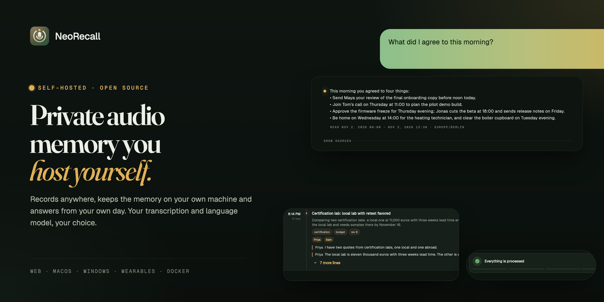
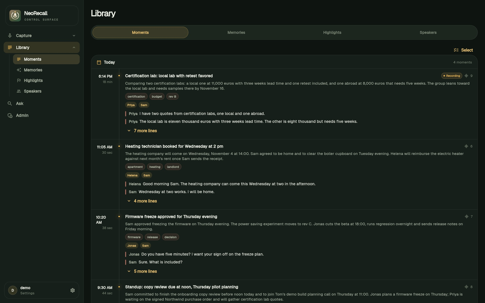
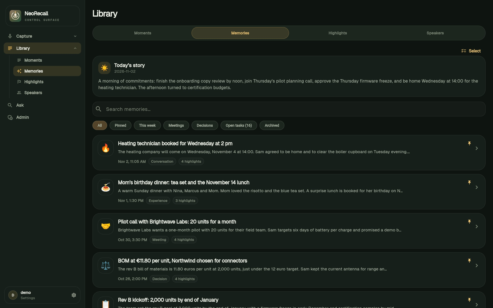
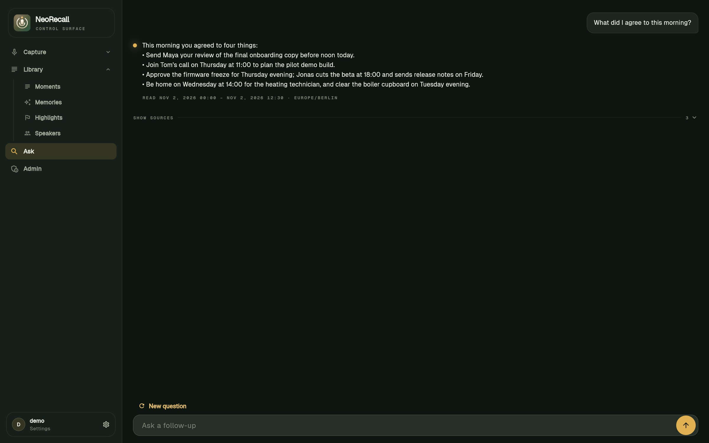
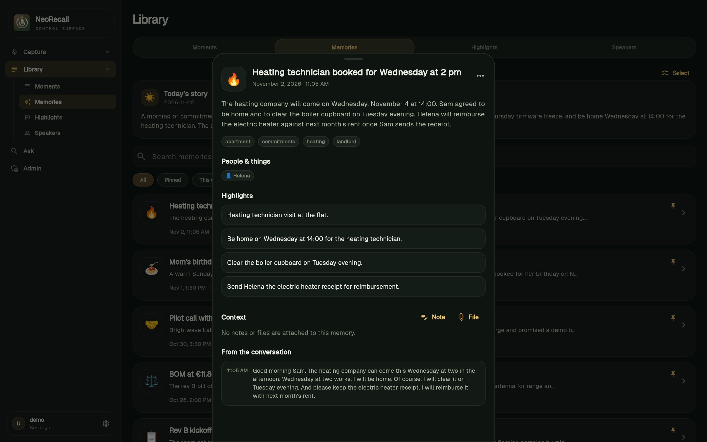

<p align="center">
  
</p>

<h1 align="center">NeoRecall</h1>

<p align="center"><strong>Private audio memory you host yourself.</strong></p>

Browser and coarse server analytics are enabled by default and can be disabled; see [analytics](docs/docs/analytics.md).

<p align="center">
  Records your day anywhere, turns every conversation into a searchable memory,<br>
  and answers from it. On your hardware, with the models you choose.
</p>

<p align="center">
  <a href="https://github.com/NeoLabs-Systems/NeoRecall/releases/latest"></a>
  <a href="LICENSE"></a>
  <a href="docs/docs/installation.md#docker-compose"></a>
  <a href="https://nodejs.org"></a>
</p>

<p align="center">
  <a href="https://github.com/NeoLabs-Systems/NeoRecall/releases/latest"></a>
  <a href="https://github.com/NeoLabs-Systems/NeoRecall/releases/latest"></a>
  <a href="https://github.com/NeoLabs-Systems/NeoRecall/releases/latest"></a>
</p>

<p align="center">
  <a href="https://discord.gg/f59rg2RwUT"></a>
</p>


https://github.com/user-attachments/assets/eb40bc78-905b-459a-bdea-a49aba3c9c09


<table>
  <tr>
    <td width="33%" valign="top">
      <h3>🏠 On your hardware</h3>
      Your server, your database, your search index.<br>
      Desktop app, Docker or one script.
    </td>
    <td width="33%" valign="top">
      <h3>🔐 Yours</h3>
      Open source under AGPL-3.0.<br>
      Any transcription and language model, local ones included.
    </td>
    <td width="33%" valign="top">
      <h3>🧾 Proof before delete</h3>
      Audio is removed only after the transcript is durable.
    </td>
  </tr>
</table>

---

## 🚀 Install

| | | |
| --- | --- | --- |
| 🖥️ **Desktop app** | macOS 13+ and Windows 10/11. **Set up NeoRecall on this computer** installs the server for you, no terminal. | [Download](https://github.com/NeoLabs-Systems/NeoRecall/releases/latest) |
| 🐳 **Docker** | Home servers, NAS boxes and VPS. | [Guide](docs/docs/installation.md#docker-compose) |
| 📜 **Script** | Linux or macOS with Git and Node.js 20+. | [Guide](docs/docs/installation.md) |

**Script**

```bash
bash <(curl -fsSL https://raw.githubusercontent.com/NeoLabs-Systems/NeoRecall/main/install.sh)
```

Then open **http://localhost:4500** once `neorecall status` reports a running service. The first account you create becomes the administrator; the app then asks for your transcription and language-model services (or an on-host model) and tests both.


## ✨ What it does

<table>
  <tr>
    <td width="33%" valign="top"><b>🎙️ Records anywhere</b><br>Browser, macOS and Windows with microphone and system audio. Quick capture sits in your tray.</td>
    <td width="33%" valign="top"><b>🧠 Memories, not transcripts</b><br>Each conversation becomes one memory with people, promises, decisions and tasks, written when it ends.</td>
    <td width="33%" valign="top"><b>💬 Ask your day</b><br>"What did I agree to this morning?" Answers cite the moments they came from.</td>
  </tr>
  <tr>
    <td valign="top"><b>🗣️ Knows who said what</b><br>Speech and voices are detected on your machine (31 MB of models). The same voice is recognized weeks later.</td>
    <td valign="top"><b>♾️ Never stops</b><br>Upload, transcription and conversation detection run during capture. Long recordings are read in windows and folded into one memory.</td>
    <td valign="top"><b>📴 Offline first</b><br>Clients buffer decodable chunks and resume idempotent uploads when the server is back.</td>
  </tr>
  <tr>
    <td valign="top"><b>📟 Wearables and devices</b><br>Omi, Plaud, Memoket and more over Bluetooth, plus NeoRecall Desk, a Raspberry Pi call recorder.</td>
    <td valign="top"><b>🎧 Meetings and voice</b><br>Zoom, Teams, Webex and FaceTime detection, and a Discord notetaker bot you run yourself.</td>
    <td valign="top"><b>🔌 NeoAgent and MCP</b><br>Connect <a href="https://github.com/NeoLabs-Systems/NeoAgent">NeoAgent</a>, or paste the MCP URL into Claude, ChatGPT or Cursor for read-only recall.</td>
  </tr>
  <tr>
    <td valign="top"><b>📝 Context</b><br>Add highlights, notes, photos and files while recording. They attach to the right memory.</td>
    <td valign="top"><b>🛡️ Consent built in</b><br>A recording notice and a persistent recording state. There is no covert mode.</td>
    <td valign="top"><b>👥 Multi-user</b><br>Per-account memory, admin role, two-factor and security keys, encrypted backups.</td>
  </tr>
</table>

**Inference:** bring any OpenAI-compatible transcription and language-model service, or run Whistle (speech to text) and Gemma 2 2B (memories and Ask) on the server itself. NeoRecall bundles no model you did not choose.

## 🧭 Explore it

| 🕒 Moments | 🧠 Memories |
| --- | --- |
|  |  |
| **💬 Ask** | **🔎 One memory** |
|  |  |

## 📚 Docs

| Start | Use | Run |
| --- | --- | --- |
| [Installation](docs/docs/installation.md) | [Recording](docs/docs/recording.md) | [Configuration](docs/docs/configuration.md) |
| [Privacy and consent](docs/docs/privacy-and-consent.md) | [NeoRecall Desk](docs/docs/desk-appliance.md) | [Troubleshooting](docs/docs/troubleshooting.md) |
| [Architecture](docs/docs/architecture.md) | [Contributing](CONTRIBUTING.md) | [Security](SECURITY.md) |

Full docs: **[neolabs-systems.github.io/NeoRecall/docs](https://neolabs-systems.github.io/NeoRecall/docs/)**

## 🧪 Project status

- **Beta.** Maintained mainly by one person. Expect breaking changes.
- **Privacy.** Read [privacy and consent](docs/docs/privacy-and-consent.md) and get the consent your jurisdiction requires before recording anyone else.
- **Help.** [Discussions](https://github.com/NeoLabs-Systems/NeoRecall/discussions) for questions, [Issues](https://github.com/NeoLabs-Systems/NeoRecall/issues) for bugs, [SECURITY.md](SECURITY.md) for vulnerabilities.

## 📄 License

[AGPL-3.0-only](LICENSE).

<p align="center"><sub>Made with ❤️ by <a href="https://github.com/neooriginal">Neo</a> · <a href="https://github.com/NeoLabs-Systems">NeoLabs Systems</a></sub></p>
